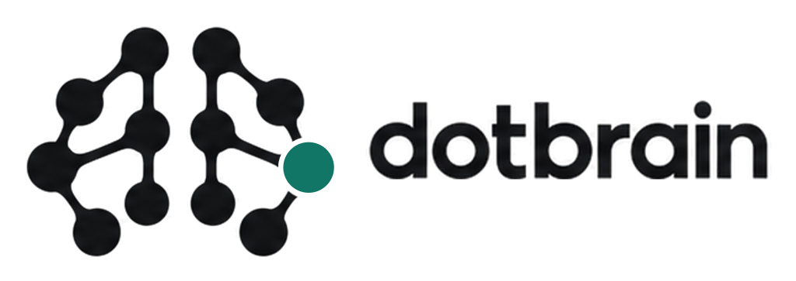
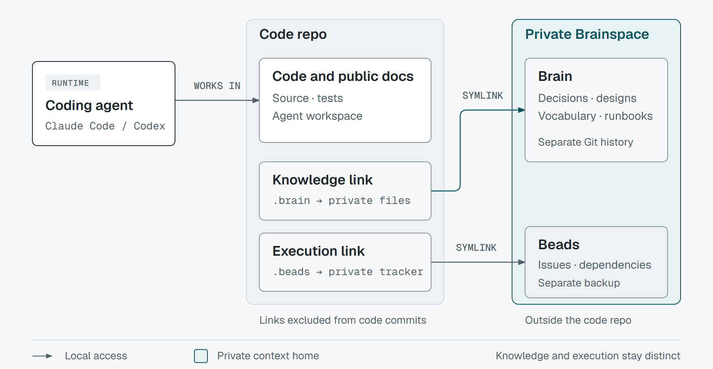

<p align="center">
  <picture>
    <source media="(prefers-color-scheme: dark)" srcset="docs/public/assets/lockup-horizontal-dark-1024.png">
    <source media="(prefers-color-scheme: light)" srcset="docs/public/assets/lockup-horizontal-light-1024.png">
    
  </picture>
</p>

# Dotbrain

[English](README.md) | 简体中文

[](https://pypi.org/project/dotbrain/)
[](https://github.com/arminzou/dotbrain/actions/workflows/ci.yml)
[](https://pypi.org/project/dotbrain/)
[](LICENSE)
[](https://arminzou.github.io/dotbrain/zh/)

**为你的 Coding Agent 管理私有项目上下文。**

支持 Claude Code、Codex、Hermes、OpenCode、Pi 和 Cursor CLI。

Dotbrain 将管理 Dotfiles 的方式用在项目上：把工作笔记、计划、agent instructions 和选用的 Agent 资源
集中保存在私有目录中，再连接到你使用的各个 checkout。

这些上下文以本地文件保存，有独立的 Git 历史。Dotbrain CLI 负责将这个工作区连接到代码仓库，
五个核心 skills 维护上下文与工作记录；规划、实现、验证和交付由你选择的工程工作流负责。

[https://github.com/user-attachments/assets/540e8945-b8bc-4fc1-ac05-c125bf768fa9](https://github.com/user-attachments/assets/021fc13a-db20-4549-8aab-b5240d289bde)

[文档](https://arminzou.github.io/dotbrain/zh/) ·
[快速开始](https://arminzou.github.io/dotbrain/zh/getting-started) ·
[工作流程](https://arminzou.github.io/dotbrain/zh/workflow)

### 为什么做 Dotbrain

Global agent instructions（如 `~/.codex/AGENTS.md` 或 `~/.claude/CLAUDE.md`）定义了我希望 Agent 平时如何做事。
Repo-level instructions（如仓库里的 `AGENTS.md` 或 `CLAUDE.md`）则约定了 Agent 在这个 repo 中该如何修改代码。
而我对某个项目的思考、工作笔记和计划，也需要一个私有的存放空间。

以前，这些内容散落在 Obsidian、被 Git 忽略的笔记和 Agent 的记忆里。每次开始新会话，
都要花时间重新整理上下文；换一个 checkout，还得重新配置常用的 skills 和 subagents。
所以我做了 Dotbrain，把这些内容集中管理，让每个 checkout 都能接入同一个项目工作区。

关于 Dotbrain 的设计思路：[Dotfiles for Your Repo](https://x.com/i/article/2109385521214390273)。

## 适合你吗？

如果你希望累积的项目上下文、进行中的计划、personal agent instructions 和选用的 skills，能在不同的 Agent、
会话和 worktree 之间持续使用，Dotbrain 可以为它们提供一个统一的私有工作区。

Dotbrain 可以与 Agent 自带的记忆系统及其他上下文工具配合使用。工作区由你掌控，
哪些结论写入仓库的共享文档、哪些整理成公开提案，都由你决定。

如果在 `AGENTS.md` 或 `CLAUDE.md` 中写几条长期适用的 instructions 就能满足需求，保持简单即可。

## 快速开始

根据你使用的 Coding Agent 选择安装方式：Claude Code 和 Codex 通过 marketplace 安装插件，
Hermes、OpenCode、Pi 和 Cursor CLI 通过 CLI 配置。无需克隆本仓库。

**Claude Code**：下面两条命令要分两次发送：

```text
/plugin marketplace add arminzou/dotbrain
/plugin install dotbrain@dotbrain
```

**Codex：**

```bash
codex plugin marketplace add arminzou/dotbrain
codex plugin add dotbrain@dotbrain
```

在 Codex 里打开 `/hooks`，信任 dotbrain 的 hook，然后新开一个 thread。
[Hermes](https://arminzou.github.io/dotbrain/zh/getting-started#hermes)、
[OpenCode](https://arminzou.github.io/dotbrain/zh/getting-started#opencode)、
[Pi](https://arminzou.github.io/dotbrain/zh/getting-started#pi) 和
[Cursor](https://arminzou.github.io/dotbrain/zh/getting-started#cursor) 则通过 CLI 安装，具体步骤见各自的文档。
Windows 用户请先开启
[开发人员模式](https://learn.microsoft.com/windows/apps/get-started/enable-your-device-for-development)
再连接项目，这样 Dotbrain 不用管理员权限也能创建目录符号链接。

接着告诉 Agent：

```text
Use wire-brain to wire this repo with Dotbrain.
```

`wire-brain` skill 会按需安装版本匹配的 CLI、`uv` 和 Beads，配置本机环境，并将仓库连接到它的私有
Brainspace。完成后，运行以下命令检查配置：

```bash
dotbrain doctor
```

在已连接的仓库中新开一个 Agent 会话，Dotbrain 会自动加载共享约定，让 Agent 知道
项目上下文存放在哪里、如何使用。
手动安装、备份、换机器配置和故障排查，见
[快速开始](https://arminzou.github.io/dotbrain/zh/getting-started)。

### 更新

插件提供五个核心 skills：`wire-brain`、`brain-convention`、`maintain-brain`、`work-graph` 和 `repo-rules`。
旧工程工作流和打包 agents 已退役，私有上下文、工作记录、笔记和用户来源保持可恢复。
更新前请阅读[breaking upgrade 指南](docs/zh/upgrading.md)。

使用 Claude Code 或 Codex 时，插件和 CLI 需要一起更新。在 Claude Code 中运行 `/plugin`，从菜单中更新 dotbrain，
再运行 `/reload-plugins`。Codex 则运行：

```bash
codex plugin marketplace upgrade
codex plugin add dotbrain@dotbrain
```

然后升级 CLI，更新本机和各项目的配置与资源：

```bash
uv tool install dotbrain@latest
dotbrain bootstrap
dotbrain refresh --all
```

如果 CLI 是通过 pipx 或 pip 安装的，请使用对应工具升级。详见
[保持更新](https://arminzou.github.io/dotbrain/zh/getting-started#staying-current)。
使用 Hermes、OpenCode、Pi 或 Cursor CLI 时，升级 CLI 后运行 `dotbrain bootstrap` 更新对应的集成，
具体说明见上方各 runtime 的安装文档。

## 工作原理

每个项目在私有的 dotbrain 主目录（默认为 `~/dotbrain/`）下都有一个 **Brainspace**，
其中包含 **Brain**（`.brain/`，用本地 Markdown 文件记录项目规则、术语、决策和设计）
和 **execution store**（`.beads/`，保存由 [Beads](https://github.com/gastownhall/beads) 跟踪的任务）。
checkout 通过符号链接访问它们。这些链接被 Git 忽略，实际文件和历史记录也保存在代码仓库之外。

<picture>
  <source media="(prefers-color-scheme: dark)" srcset="docs/public/assets/how-it-works-dark.png">
  <source media="(prefers-color-scheme: light)" srcset="docs/public/assets/how-it-works-light.png">
  
</picture>

图中以 Claude Code 和 Codex 为例，所有受支持的 runtime 都使用同样的 Brainspace 结构。

连接项目时，Dotbrain 会将选用的 skills 配置到各 runtime 的项目 skills 目录中。
选中的自定义 native subagents 支持 Claude Code 和 Codex：Claude 资源在 `.claude/` 下，Codex skills 在
`.agents/skills/` 下，Codex subagents 在 `.codex/agents/` 下。Codex 配置仍留在 `.codex/` 下。
Skills 和 Claude subagents 使用符号链接，Codex subagents 则使用自动生成、被 Git 忽略的
TOML 文件。连接 Git worktree 时，会复用主 checkout 已有的 Brainspace，
两边共用同一份项目知识和任务记录。
Hermes、OpenCode、Pi 和 Cursor CLI 支持 skills 和会话集成，但 Dotbrain 不会为它们配置 native subagents。

会话开始时，各 runtime 的集成提供共享约定 `DOTBRAIN.md`；选择 pstack 的项目另附有大小限制的发现指针。不同 runtime 的上下文加载和同步方式，
见[运行时说明](https://arminzou.github.io/dotbrain/zh/session-context#runtime-notes)。
公开的 `AGENTS.md` 会要求 Agent
在修改或审阅代码前，读取仓库根目录下由 Git 跟踪的 `RULES.md`；这些规则在没有 Brain 的环境中也适用。
`repo-rules` 只在明确请求时初始化要求，保留本地修订；评估出的改进在获采纳前仍是提案。
上下文检索与记录时机由所选工作流决定，现有私有笔记保留，不要求强制复盘。

新建 Brain 不再生成私有的 `AGENTS.md` 和 `CLAUDE.md`，也不再将它们作为指令入口。
`wire` 和 `refresh` 会保留旧文件和已有的上下文引用，但不会要求它们存在，也不会重新生成。
删除旧文件前，先按内容归属迁移有用的信息：仓库要求放在公开的 `RULES.md`，私有知识留在 Brain。
个人偏好不会因此自动变成所有贡献者都要遵守的公共要求。
加载顺序见[会话上下文](https://arminzou.github.io/dotbrain/zh/session-context)。

`dotbrain projects list` 可以列出已注册的项目。在已连接的 checkout 里，
`dotbrain refresh` 更新当前 checkout 的配置与资源，`dotbrain unwire` 断开连接，但保留共享的
Brainspace。在其他目录中，可用 `--project <name>` 指定项目；`refresh --all`
会处理所有已注册的项目。全局资源需要单独更新，运行 `skills link --scope global` 或
`subagents link --scope global`。

Brain 使用 Git 管理版本，请将它备份到**私有**远程仓库。Beads 数据库不纳入 Git，
备份或共享任务需要另行配置 Dolt remote 或共享服务器。
详见[架构](https://arminzou.github.io/dotbrain/zh/architecture)、
[项目连接](https://arminzou.github.io/dotbrain/zh/wiring)和
[Beads 后端](https://arminzou.github.io/dotbrain/zh/beads-backend)。

## 选择工作流

Brain 保存项目理解，Beads 保存持久任务、归属和执行证据，公开 `RULES.md` 保存已采纳的仓库要求。
核心提供这些记录的操作，不规定工程执行链。

可选的 `dotbrain-pstack` mode 通过项目的 `pstack.enabled` 和显式外部 `pstack.source` checkout 选择，
使用固定 pstack 能力开展工程工作，并接入 Brain 与 Beads。安装 Dotbrain 本身不启用或安装 pstack。
首批 native 验证目标是 Windows 本地 Claude Code 和 Codex；结构交付与观测到的 Agent 行为需要分别证明。
精确依赖、配置、证据边界、退出和升级方式见[工作流设置与验证范围](docs/zh/workflow.md)。

其他工作流也能使用相同的五个核心能力。规划、分派、验证、恢复和交付由所选工作流负责，受用户和仓库授权约束。
选择 mode 不授予发布、合并或 release 权限。

## 开发

CLI 是一个用 [uv](https://docs.astral.sh/uv/) 管理的 Python 包。

```bash
git clone https://github.com/arminzou/dotbrain.git
cd dotbrain
uv sync
uv run dotbrain --help
uv run pytest
```

如需以 editable 模式安装 CLI，运行 `./scripts/dev-install.sh`（Windows 上为
`.\scripts\dev-install.ps1`），再运行 `dotbrain bootstrap`。
内置 skills 的源码在 [`plugin/skills/`](plugin/skills/)。
命令和选项见 [CLI 参考](https://arminzou.github.io/dotbrain/zh/cli-reference)。

提交 bug 或 PR 前，请先阅读[贡献指南](CONTRIBUTING.md)。

本项目采用 [MIT 许可证](LICENSE)。
