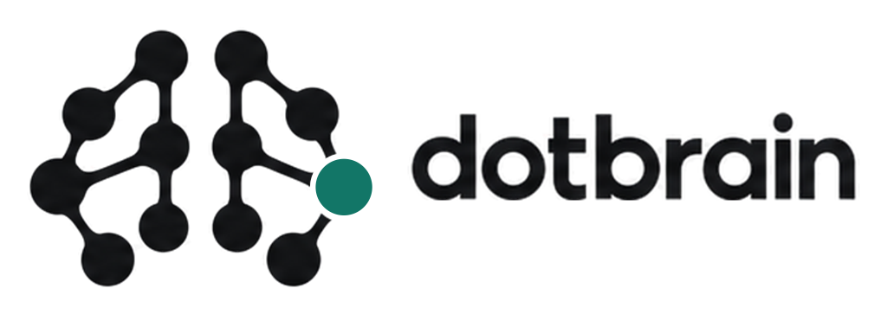
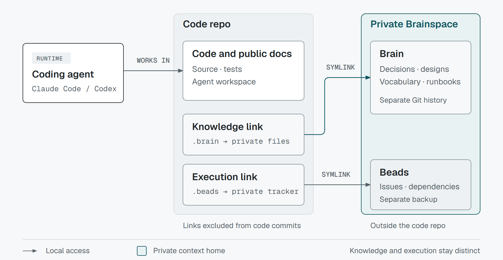
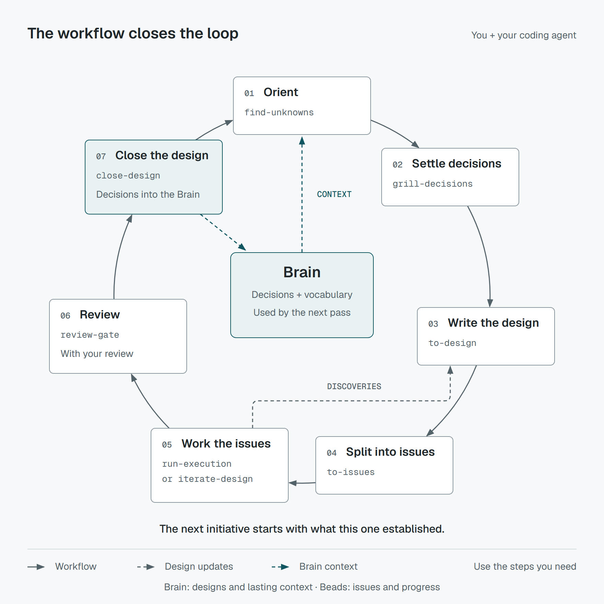

<p align="center">
  <picture>
    <source media="(prefers-color-scheme: dark)" srcset="docs/public/assets/lockup-horizontal-dark-1024.png">
    <source media="(prefers-color-scheme: light)" srcset="docs/public/assets/lockup-horizontal-light-1024.png">
    
  </picture>
</p>

# Dotbrain

[English](README.md) | 简体中文

[](https://pypi.org/project/dotbrain/)
[](https://github.com/arminzou/dotbrain/actions/workflows/ci.yml)
[](https://pypi.org/project/dotbrain/)
[](LICENSE)
[](https://arminzou.github.io/dotbrain/zh/)

**给 Claude Code 和 Codex 用的私有项目上下文。**

Dotbrain 把管理 Dotfiles 的思路搬到了项目上：工作笔记、计划、指令，还有你挑好的 Agent
资源，统一放在一个私有目录里，要在哪个 checkout 干活，就接到哪个 checkout。

这些上下文就是本地文件，有自己独立的 Git 历史。Dotbrain CLI 负责把这个工作区接到代码仓库上；
插件自带的工作流技能则教 Agent 怎么用这些上下文，并和你一起把它维护下去。

[https://github.com/user-attachments/assets/540e8945-b8bc-4fc1-ac05-c125bf768fa9](https://github.com/user-attachments/assets/021fc13a-db20-4549-8aab-b5240d289bde)

[文档](https://arminzou.github.io/dotbrain/zh/) ·
[快速开始](https://arminzou.github.io/dotbrain/zh/getting-started) ·
[工作流程](https://arminzou.github.io/dotbrain/zh/workflow)

### 为什么做这个

Agent Harness的全局指令管的是我希望 Agent 平时怎么做事，仓库里的共享指令管的是所有人该怎么改这份代码。
可我自己对某个项目的思考、工作笔记和计划，也得有个私密的地方放。

以前这些东西散落在 Obsidian、被 gitignore 的笔记和 Agent 的记忆里，每次要找出来、
带进新会话都很费劲；换个新 checkout，还得把常用的技能和子 Agent 重新配一遍。
所以我做了 Dotbrain：把项目工作区收在一处，接到哪儿干活都是同一套流程。

想了解来龙去脉，可以读 [Dotfiles for Your Repo](https://x.com/i/article/2109385521214390273)（英文）。

## 适合你吗？

如果你想要一个私有的项目工作区，并且希望它能跨 Agent、跨会话、跨 worktree 一直用下去，
Dotbrain 就适合你：攒下来的上下文、做到一半的计划、你给这个项目定的指令和挑的技能，
都在里面。

它不排斥 Agent 自带的记忆系统，也可以和其他上下文工具搭配着用。工作区归你自己；
哪些结论该写进仓库的共享文档、哪些该整理成公开提案，都由你决定。

如果在 `AGENTS.md` 或 `CLAUDE.md` 里写几条常驻指令就够用，那就不用搞这么复杂。

## 快速开始

把插件装进你的 Coding Agent 就行，不用克隆这个仓库。

**Claude Code**：下面两条命令要分两次发送：

```text
/plugin marketplace add arminzou/dotbrain
/plugin install dotbrain@dotbrain
```

**Codex：**

```bash
codex plugin marketplace add arminzou/dotbrain
codex plugin add dotbrain@dotbrain
```

在 Codex 里打开 `/hooks`，信任 dotbrain 的 hook，然后新开一个 thread。
Windows 用户请先开启
[开发人员模式](https://learn.microsoft.com/windows/apps/get-started/enable-your-device-for-development)
再连接项目，这样 Dotbrain 不用管理员权限也能创建目录符号链接。

接着告诉 Agent：

```text
Use wire-brain to wire this repo with Dotbrain.
```

这个技能会按需安装版本匹配的 CLI、`uv` 和 Beads，配好本机环境，再把仓库接到它的私有
Brainspace 上。装完可以检查一下：

```bash
dotbrain doctor
```

在接好的仓库里新开一个 Agent 会话，Dotbrain 的共享约定就会自动加载，告诉 Agent
项目上下文在哪儿、该怎么用。
手动安装、备份、换机器配置和故障排查，见
[快速开始](https://arminzou.github.io/dotbrain/zh/getting-started)。

### 更新

插件和 CLI 要一起更新。在 Claude Code 里运行 `/plugin`，从菜单中更新 dotbrain，
再运行 `/reload-plugins`。Codex 则运行：

```bash
codex plugin marketplace upgrade
codex plugin add dotbrain@dotbrain
```

然后升级 CLI，并同步本机和各个项目：

```bash
uv tool install dotbrain@latest
dotbrain bootstrap
dotbrain refresh --all
```

如果 CLI 是用 pipx 或 pip 装的，就用对应的工具升级。详见
[保持更新](https://arminzou.github.io/dotbrain/zh/getting-started#staying-current)。

## 工作原理

每个项目在你私有的 dotbrain 主目录（默认是 `~/dotbrain/`）下都有一个 **Brainspace**，
里面有两样东西：**Brain**（`.brain/`，一组本地 Markdown 文件，记录项目规则、术语、
决策和设计）和**执行存储**（`.beads/`，用 [Beads](https://github.com/gastownhall/beads)
跟踪的任务）。checkout 通过被 gitignore 的符号链接访问它们，文件本身和历史记录都不进代码仓库。

<picture>
  <source media="(prefers-color-scheme: dark)" srcset="docs/public/assets/how-it-works-dark.png">
  <source media="(prefers-color-scheme: light)" srcset="docs/public/assets/how-it-works-light.png">
  
</picture>

连接项目时，你选的技能和子 Agent 也会一并放进仓库里的 Agent 工作区 `.claude/` 和 `.codex/`。
技能和 Claude 子 Agent 是符号链接，Codex 子 Agent 则是自动生成、被 gitignore 的
TOML 文件。连接 Git worktree 时，它会接到主 checkout 已有的 Brainspace 上，
两边共用同一份项目知识和任务记录。

会话开始时，插件的 hook 只加载共享约定 `DOTBRAIN.md`。公开的 `AGENTS.md` 会指引 Agent
在修改或审阅代码时读取仓库根目录下、由 Git 跟踪的 `RULES.md`，没有 Brain 也能用。
lead 或独立工作的 Agent 会按任务搜索私有复盘记录，把相关发现随任务分派给 worker 和 reviewer；
hook 不会注入整份复盘笔记。新建 Brain 会生成私有的 `AGENTS.md`，保存少量个人偏好和项目私有规则，
`CLAUDE.md` 是它的符号链接。Agent 在开始实质工作前读取它，会话启动时不注入。
wire 和 refresh 保留已有内容和上下文指针。仓库要求放在公开的 `RULES.md`，个人偏好保持私有。
加载顺序见[会话上下文](https://arminzou.github.io/dotbrain/zh/session-context)。

`dotbrain projects list` 可以列出已注册的项目。在已连接的 checkout 里，
`dotbrain refresh` 维护当前 checkout，`dotbrain unwire` 断开连接但保留共享的
Brainspace。在别的目录下，用 `--project <name>` 指定项目；`refresh --all`
会处理所有已注册的项目。全局资源不会顺带同步，需要显式运行 `skills link --scope global` 或
`agents link --scope global`。

Brain 用 Git 做版本管理，记得备份到**私有**远程仓库。Beads 数据库不进 Git，
想备份或共享任务，得另外配一个 Dolt remote 或共享服务器。
详见[架构](https://arminzou.github.io/dotbrain/zh/architecture)、
[项目连接](https://arminzou.github.io/dotbrain/zh/wiring)和
[Beads 后端](https://arminzou.github.io/dotbrain/zh/beads-backend)。

## 工作闭环

每做完一件事，都应该让下一个会话知道得更多。Dotbrain 内置的技能带着工作从想法走到实现，
再把过程中学到的东西写回项目上下文。

<picture>
  <source media="(prefers-color-scheme: dark)" srcset="docs/public/assets/workflow-dark.png">
  <source media="(prefers-color-scheme: light)" srcset="docs/public/assets/workflow-light.png">
  
</picture>

闭环体现在两处：

- **工作过程中：** 新发现会回流到当前的设计和受影响的任务里。比如中途撞上一个没料到的
  API 限制，它就成了一个设计问题；等你拿定主意，先把决策写进设计和任务，再接着实现。
- **你合并 PR 并手动结束设计之后：** 结束设计时会记下验证证据，并把有用的决策和术语沉淀到 Brain 里。
  下一项工作开始时，这些知识已经是现成的。

Brain 存长期知识，设计存当前意图，Beads 存执行状态。每次交接都落在文档或任务记录里，
换一个会话、换一个 Agent，都能接着往下做。

成功标准、PR 批准、合并和发布由你决定。执行前先解决可预见的决策，明确执行范围和权限；
完整且仍适用的授权可以直接复用，不必反复确认。Agent 完成检查、验收/UAT 和必要审阅后，
把 PR 标为 ready 并请求你审阅。遇到新的范围、权限或验收标准问题，先停下受影响的工作，
带上证据和建议交给你决定。恢复执行也不会重置次数或预算上限。设计保持 active，直到你手动
调用 closeout；PR 关闭但未合并不算交付。工作要跨多个会话，或者还有没想清楚的问题时，就走完整个闭环；
小改动挑用得上的几步就行。

操作示例见[工作流程](https://arminzou.github.io/dotbrain/zh/workflow)，
完整的技能列表见[技能](https://arminzou.github.io/dotbrain/zh/skills)。

## 开发

CLI 是一个用 [uv](https://docs.astral.sh/uv/) 管理的 Python 包。

```bash
git clone https://github.com/arminzou/dotbrain.git
cd dotbrain
uv sync
uv run dotbrain --help
uv run pytest
```

想以 editable 模式安装 CLI，运行 `./scripts/dev-install.sh`（Windows 上是
`.\scripts\dev-install.ps1`），再运行 `dotbrain bootstrap`。
内置技能的源码在 [`plugin/skills/`](plugin/skills/)。
命令和选项见 [CLI 参考](https://arminzou.github.io/dotbrain/zh/cli-reference)。

提 bug 或 PR 之前，请先看[贡献指南](CONTRIBUTING.md)。

本项目采用 [MIT 许可证](LICENSE)。
