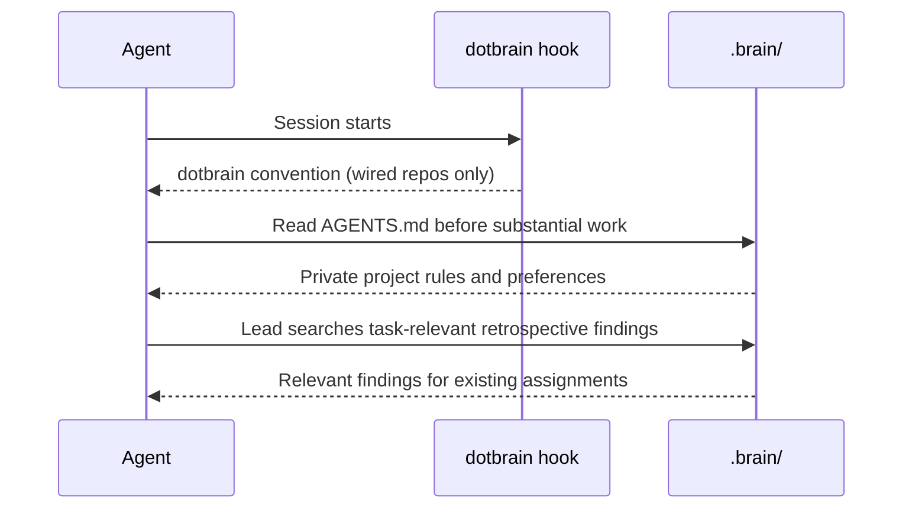

# Session Context

A wired repo's agent session starts with the dotbrain convention already in context. This page
explains what gets injected, how, what the agent reads on its own, and how the session's hooks keep
the dotbrain home in sync.

## What Happens at Session Start

The plugin's `SessionStart` hook runs `dotbrain hook session-start`. It fires on startup, resume,
`/clear`, and compaction, so the convention survives a context reset. Before it injects the
convention, it runs [home sync](#home-sync).

## What Is Injected

Only `.brain/DOTBRAIN.md`, the shared convention that dotbrain owns and keeps current through
`dotbrain refresh`. It covers wiring rules, where execution lives, the public/private boundary, and
how the Brain is laid out.

The project's own files are not injected:

| File | Loaded how |
| --- | --- |
| `.brain/DOTBRAIN.md` | Injected by the hook |
| `.brain/AGENTS.md` | Read before substantial work for private rules and preferences; never injected |
| Public `AGENTS.md` and root `RULES.md` | Repository entry point routes making/reviewing changes to tracked rules, usable without a Brain |
| `.brain/RETRO.md` | Lead or sole agent searches relevant findings during implementation or review preparation; passes them through assignments |
| `.brain/CONTEXT.md`, `adr/`, `designs/` | Read by the agent when the work needs them |
| `.brain/docs/` | Searched by the agent before it answers how the project works |
| Beads workflow primer | Not injected by dotbrain; the agent runs `bd prime` when it needs it |

To have the Beads primer injected too, add Beads' own hook with `bd setup claude` or
`bd setup codex`. Dotbrain does not install it.

::: info Why not inject everything?
Dotbrain tests its session-start payload against a 10,000-byte budget. This budget comes from
measured Claude Code behavior: 9,961 bytes reached the model, while 10,010 bytes were written to
a file instead. It is not a verified limit for every runtime. `DOTBRAIN.md` has a bounded size;
repository rules and retrospective notebooks grow with the project. Injecting only the convention keeps the payload
within that budget.
:::

## Home Sync

The plugin registers three hooks. Each one syncs the dotbrain home, the Git repository that holds
every Brainspace, so Brain changes reach your other machines without a manual commit and push.

| Hook | Runs | What it does |
| --- | --- | --- |
| `SessionStart` | `dotbrain hook session-start` | Runs a full sync and waits up to 10 seconds, then injects the convention. A slower sync keeps running in the background, and the session starts from local state. On compaction it only records and pushes, because compaction happens mid-turn. |
| `Stop` | `dotbrain hook stop` | After each turn of the main agent, starts a background sync that records and pushes without fetching, and returns at once. Files never change under a running agent. |
| `SessionEnd` | `dotbrain hook session-end` | Starts a full sync in the background and returns at once; skipped on `/clear`, whose `SessionStart` syncs. |

Hooks for other runtimes call `dotbrain hook run` instead, which reads no hook payload. It takes
the event as `--event startup|resume|clear|compaction|turn-end|session-end`, the checkout as
`--checkout PATH` (default: the working directory), and `--format json` to print the convention
as `{"additional_context": "..."}`. Each event syncs as its hook above does: the session starts
(`startup`, `resume`, `clear`) wait for a full sync and inject the convention; `compaction` and
`turn-end` only record and push; `session-end` starts a full sync. A cleared session sends only
`clear`, never `session-end`.

A full sync runs four steps:

1. **Record.** Every uncommitted change becomes a sync commit: one per changed Brainspace, then one
   `home` commit for everything else. Files over the size limit and nested Git repositories are
   skipped and reported. Commits you wrote yourself are left alone.
2. **Fetch** the upstream of the home's current branch.
3. **Integrate.** Merge the upstream into the current branch. When both machines changed a file,
   this machine's version stays in place and the other machine's version is saved beside it as a
   conflict copy. When one side deleted a file
   and the other edited it, the edit wins. If incoming changes would overwrite an uncommitted or
   ignored local file, Git refuses the merge and sync reports its diagnostic without pushing.
4. **Push.** If the remote moved in the meantime, sync fetches and tries again, at most three
   times. It never force-pushes.

Home sync is quiet and fails open. It writes nothing to the agent's context, and a failure never
blocks the session. Offline machines and homes without a remote keep their sync commits locally
until a later sync can push them. Hooks sync only in a checkout wired to a Brainspace, or in the
dotbrain home itself. A lock keeps two syncs on one machine apart. The full sync at session start
briefly waits for a busy lock within its 10-second bound. The push-only sync after compaction and
other sync entrypoints return at once if the lock is busy. Run `dotbrain sync` to sync by hand,
and `dotbrain doctor` to see waiting commits, conflict copies, and skipped files. To turn sync
off, see [`sync:`](configuration.md#sync).

Home sync does not sync the Beads tracker; `dotbrain beads sync` keeps its own path.

::: warning Known limits
- Sync unstages everything before it records, so state that exists only in the index (partially
  staged hunks, `git rm --cached`, a staged mode change) is replaced by the working tree.
- Nested Git repositories inside the home are never recorded.
- A Git command you run in the home while a hook is committing can hit Git's lock error. Run it
  again.
- When two machines changed the same lines, the merge that resolves the conflict rewrites those
  files in the shared home. Another session on the same machine can briefly see or overwrite them
  during that step. Sync refuses to merge over uncommitted edits that Git would overwrite.
:::

## Failing Open

The hook never blocks a session. Outside a git repo, in a repo that is not wired, or when
`dotbrain` is not on `PATH`, it prints nothing and exits cleanly. The cost of that choice is that a
broken setup is silent: if a session in a wired repo does not know the convention, run
`dotbrain doctor`. See [Troubleshooting](troubleshooting.md#the-agent-does-not-know-the-project).

## Runtime Notes

- **Claude Code** runs the hooks as soon as the plugin is installed.
- **Codex** runs plugin hooks only after you trust them: open `/hooks` in `codex`, trust the
  dotbrain hooks, and start a new thread. Until then Codex sessions get no injected convention and
  do not sync. Codex runs session-end hooks with a short time limit, so that hook only launches the
  sync and returns. Whether Codex fires `Stop` for the main thread only, and whether it runs the
  `Stop` hook in the background, is not yet verified. Stop and session-end syncs exit at once if
  another sync is running, and a push-only sync returns quickly.
- **Hermes** (Linux only; see [Hermes on Linux](getting-started.md#hermes)) runs the hooks once
  the plugin is enabled. Before the first model request of a session, the plugin runs
  `dotbrain hook run --event startup` and adds the convention to that first user message, not to
  the system prompt. Hermes keeps it in the session history, so a resumed session runs `resume` for
  the sync but gets no second copy. When compaction drops it from the history, the next turn runs `compaction`
  and adds it again. By default Hermes moves hook context over 10,000 characters to a file, so a convention
  must stay below that size. Hermes fires its own session-end hook after every turn, so that hook
  starts the `turn-end` push in the background. A real exit runs `session-end`. Delegated child
  agents get no convention and no sync.
- **OpenCode** (native Windows only; see [OpenCode on Windows](getting-started.md#opencode)) runs
  the hooks once the plugin file is in its config directory. Before the first model request of a
  session, the plugin runs `dotbrain hook run --event startup` and adds the convention to the
  system prompt of every request in that session; a session this OpenCode process did not create,
  such as one continued with `opencode run -c`, runs `resume` instead. After compaction it runs
  `compaction` and keeps adding the convention. When a run finishes and the session goes idle, it
  starts the `turn-end` push in the background. When OpenCode exits, it starts `session-end` for
  each idle session. Killing OpenCode or closing its window skips that step; the next session
  start syncs what was left. A config reload also shuts the plugin down, but while a session is
  still running it only pushes. Task subagents get no convention and no sync.
- In a runtime with no hook support, invoke the `dotbrain` skill to load the convention by hand,
  and run `dotbrain sync` yourself.

## Subagents

See [Working with an agent team](agent-team.md#the-packaged-subagents) for when to use each role,
example prompts, and how the lead coordinates their results.

dotbrain ships packaged subagents. Claude Code receives them from the plugin as
`dotbrain:<role>`, for example `dotbrain:worker`. Codex has no plugin agents, so `dotbrain wire`
generates them into each wired checkout as `dotbrain-<role>`, for example `dotbrain-worker`.
Hermes and OpenCode get no dotbrain subagents.
Each loads the authority relevant to its assignment; workers and reviewers reuse supplied findings
without reading the whole retrospective notebook. A missing notebook blocks nothing and is not scaffolded:

| Subagent | Does |
| --- | --- |
| `worker` | The writing worker: carries out an assigned change in your checkout or its own worktree, and commits it |
| `reviewer` | Reviews a change for correctness, regressions, security, and missing tests |
| `verifier` | Runs the verification gate and returns commit-stamped evidence, never an opinion |
| `researcher` | Answers a question from the Brain, the codebase, and the web, and flags where outside sources and the Brain disagree. On Codex it reads local files with shell commands under the lead session's permissions; its instructions forbid writes and network commands, but a lead with broader permissions passes them to it |

The packaged subagents can't be overridden: a file with the same name in your private agent
sources is ignored. To customize one, write your own agent under a different name. Add your own
subagents under `subagents:` in [`project.yaml`](configuration.md#project-yaml), or under
`global:` in `agents/agents.yaml`; `dotbrain bootstrap` prepares the global ones in your runtime homes.

Your own Claude definitions are delivered as symlinks. Codex definitions are real TOML copies
generated with `# dotbrain-managed-agent: v1`; dotbrain can overwrite or prune them. `dotbrain agents link` reconciles the current wired checkout;
use `--scope global` for global homes. Doctor checks file type and delivered content, while a
successful role spawn confirms the runtime actually consumed a definition.

The packaged Codex reviewer disables cross-session memory. It still receives project instructions
and reads the relevant Brain records and assigned skills. Give it the exact change, acceptance
criteria, and authority sections it needs. Its high reasoning effort is unchanged. This setting
does not change memory in your lead session or other roles.
