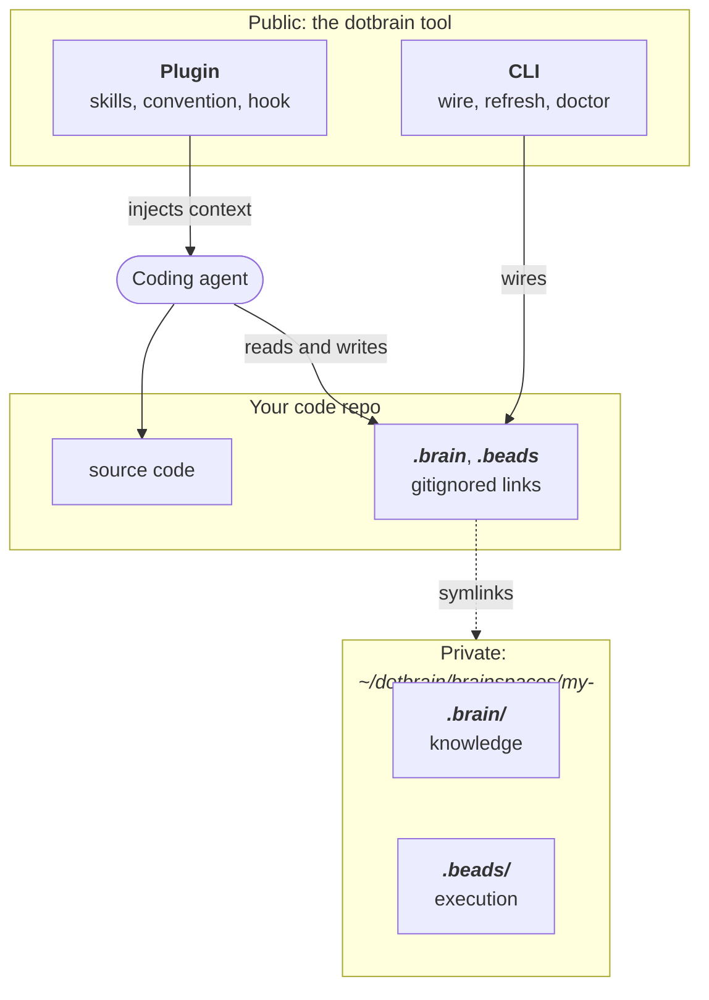
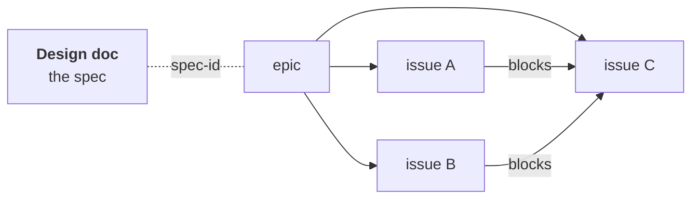

# 架构

本页解释 dotbrain 的设计：Brainspace、Brain 与执行的分离、skills，以及公开/私有的边界。

## 全局视图 {#the-big-picture}

三个部分，三个归属：

- **工具**是公开的，对所有人都一样。
- **dotbrain 主目录**是你自己的，私有。它存放所有项目的 Brainspace，作为一个 Git 仓库统一做版本管理。
- **代码仓库**还是原来的代码仓库，只是多了被忽略的本地连接和生成的 runtime 资源。

## Brainspace {#brainspaces}

**Brainspace** 是每个项目一个的目录，存放 Agent 需要、但不属于代码本身的一切：

- `.brain/` 是项目的知识。
- `.beads/` 是执行存储：任务、依赖和计划。

代码仓库通过被 gitignore 的 `.brain` 和 `.beads` 符号链接访问它的 Brainspace。仓库里的 `.claude` 和
`.codex` Agent 工作区是真实目录，Codex 项目 skills 单独放在 `.agents/skills`。dotbrain 添加逐个被忽略的
skills 链接、Claude Agent 链接和带标记的
Codex Agent 文件，不会占用项目自己的文件。Agent 看到的是一棵完整的目录树，仓库保持干净，上下文保持私有。
细节见[项目连接](wiring.md)。

## Brain {#the-brain}

Brain 里的每个部分各有一个用途：

| 部分 | 内容 | 何时变化 |
| --- | --- | --- |
| `CONTEXT.md` | 领域术语：任务、计划和代码里用的名字 | 一个概念被命名或定义得更精确时 |
| `adr/` | 架构决策记录（ADR），每个决策一条 | 做出一个难以撤回、有真实取舍的选择时 |
| `designs/` | 设计文档，每项工作一个文件 | 一项工作被规划、实现或结束时 |
| `DOTBRAIN.md` | 共享约定，由 dotbrain 维护 | `dotbrain refresh` 更新它时 |
| `project.yaml` | runtime、任务跟踪、skills 和 subagents 的选择 | 你改变项目使用的东西时 |
| `docs/` | 派生的操作手册和参考资料 | 随时；从不作为权威依据 |

所选工程工作流负责规划、选择任务、分派、验证、恢复与交付。核心记录操作保留证据、授权与生命周期含义，
不规定工程执行链。Beads 保存持久执行状态；任务内可使用临时程序清单。
关闭任务或打开 PR 本身不代表已交付。

私有文件通过 home sync 保留独立 Git 历史；Beads 使用自己的后端存储与备份。
公开 `AGENTS.md` 指向 `RULES.md` 中已采纳的仓库要求，由 `repo-rules` 维护。
初始化需要明确请求，提案不等于采纳。现有复盘笔记仍是私有历史资料，不要求检索、整理或写入复盘。
启动时提供共享工作区约定；选择 mode 时另附有大小限制的发现指针。

新建 Brain 不再生成私有的 `AGENTS.md` 和 `CLAUDE.md`，也不再将它们作为指令入口。
wire 和 refresh 会保留旧文件及已有的上下文引用，但不会要求它们存在，也不会重新生成。
删除旧文件前，先将有用内容迁移到已有的归属位置：仓库要求放在公开的 `RULES.md`，
私有词汇、决策、设计和参考资料仍留在 Brain。个人偏好不会自动变成公共要求。

ADR 记录的是难以撤回、没有上下文会让人意外、并且经过真实取舍的决策。**active** 的设计是这项工作的
权威依据；一旦变成 **shipped**、**abandoned** 或 **superseded**，它就冻结为一份记录，需要长期保留的内容
转移到 `adr/` 和 `CONTEXT.md`。[工作流程](workflow.md)介绍了这个生命周期。

工程程序由所选工作流负责。Brain 文件通过 home sync 纳入私有 home 的 Git 历史，Beads 使用单独后端。

## 执行状态放在任务跟踪里 {#execution-lives-in-the-tracker}

持久任务状态保存在**执行存储**中，默认是
[Beads](https://github.com/gastownhall/beads)，一个能感知依赖关系的任务跟踪工具。多步骤的工作是一个带
`blocks` 依赖的 epic，所以“哪些可以开始做”只是一次查询：

设计说明要去哪里，任务跟踪说明现在在哪里。执行存储是按配置同步的本机 runtime 状态，所以同一个项目可以
在一台机器上用 embedded 模式运行，在另一台机器上连接共享服务器。详见 [Beads 后端](beads-backend.md)。

## Skills {#skills}

skills 是可复用的 Agent 能力，归工具所有，而不是归某个项目所有。插件提供五个独立于工程工作流的核心 skills，
还可交付用户选择的资源，以及明确启用的项目 pstack mode。见[工作流选择](workflow.md)。

链接是幂等的：dotbrain 只创建和清理它自己的链接。它从不删除真实文件，也不删除不是它创建的链接，
所以内置 skills 可以和私有 skills 在同一台机器上并存。详见[Skills](skills.md)。

## 会话开始 {#session-start}

运行一次 `dotbrain bootstrap` 准备好全局 skills 和 subagents。之后，在已连接仓库里的每个 Agent 会话开始时，
插件的 hook 都会注入 dotbrain 约定，所以 Agent 一开始就知道 Brain 在哪、怎么用。
详见[会话上下文](session-context.md)。

## 公开/私有的边界 {#the-public-private-boundary}

决定一切的那个决策：**工具是公开的，你的数据是私有的。**

- 这个仓库就是工具：CLI、插件、skills、模板。
- 你的 Brainspace 放在一个单独的数据目录里，由安装好的工具来操作。
- 工具里从不包含项目数据，Brain 也从不被复制到代码仓库里。
- 需要公开某些内容时，你要为那些读者**重新写**一份文档，而不是把私有的原文公开出去。

正是这条边界，让同一个开源工具可以服务完全私有的工作。
