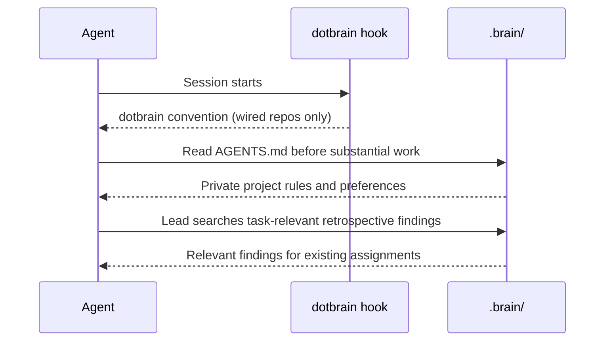

# 会话上下文

在已连接的仓库里，Agent 会话一开始，dotbrain 约定就已经在上下文里了。本页解释注入了什么、怎么注入的，
Agent 会自己去读哪些内容，以及会话的 hook 怎样同步 dotbrain 主目录。

## 会话开始时发生了什么 {#what-happens-at-session-start}

插件的 `SessionStart` hook 运行 `dotbrain hook session-start`。这个 hook 在启动、恢复会话、
`/clear` 和上下文压缩时都会触发，所以约定在上下文重置后依然存在。注入约定之前，它会先运行
[主目录同步](#home-sync)。

## 注入了什么 {#what-is-injected}

只有 `.brain/DOTBRAIN.md`，也就是由 dotbrain 维护、通过 `dotbrain refresh` 保持最新的共享约定。
它涵盖连接规则、执行状态放在哪里、公开/私有的边界，以及 Brain 的目录结构。

项目自己的文件不会被注入：

| 文件 | 加载方式 |
| --- | --- |
| `.brain/DOTBRAIN.md` | 由 hook 注入 |
| `.brain/AGENTS.md` | 实质工作前读取私有规则和个人偏好，不注入 |
| 公开的 `AGENTS.md` 和根目录 `RULES.md` | 仓库入口指引修改或审阅代码的 Agent 读取 Git 跟踪的规则，没有 Brain 也能用 |
| `.brain/RETRO.md` | lead 或独立工作的 Agent 在实现或审阅准备时搜索相关发现，随任务分派传递 |
| `.brain/CONTEXT.md`、`adr/`、`designs/` | 工作需要时由 Agent 读取 |
| `.brain/docs/` | Agent 在回答项目如何运作之前先搜索这里 |
| Beads 工作流入门 | dotbrain 不注入；Agent 需要时运行 `bd prime` |

如果也想注入 Beads 的入门说明，可以用 `bd setup claude` 或 `bd setup codex` 添加 Beads 自己的 hook。
dotbrain 不会安装它。

::: info 为什么不全部注入？
dotbrain 用 10,000 字节的预算测试会话启动时注入的内容。这个预算来自对 Claude Code 实际行为的测量：
9,961 字节到达了模型，而 10,010 字节则被写到了一个文件里。它不是在所有运行时上都验证过的上限。
`DOTBRAIN.md` 的大小是有上限的，而仓库规则和复盘笔记会随项目增长。只注入约定，就能让内容保持在预算以内。
:::

## 主目录同步 {#home-sync}

插件注册了三个 hook。每个都会同步 dotbrain 主目录，也就是存放所有 Brainspace 的那个 Git 仓库。这样
Brain 的改动不用手动提交和推送，就能到达你的其他机器。

| Hook | 运行 | 做什么 |
| --- | --- | --- |
| `SessionStart` | `dotbrain hook session-start` | 运行一次完整同步，最多等 10 秒，然后注入约定。超时的同步会在后台继续跑完，会话从本地状态开始。上下文压缩时只记录和推送，因为压缩发生在一轮对话中间。 |
| `Stop` | `dotbrain hook stop` | 主 Agent 每轮结束后，在后台启动一次只记录和推送、不 fetch 的同步，然后立即返回。文件不会在 Agent 运行时被改动。 |
| `SessionEnd` | `dotbrain hook session-end` | 在后台启动一次完整同步，然后立即返回。 |

一次完整同步分四步：

1. **记录。** 所有没提交的改动都变成同步提交：每个有改动的 Brainspace 一个，其余改动合成一个
   `home` 提交。超过大小上限的文件和嵌套的 Git 仓库会被跳过并报告。你自己写的提交保持不变。
2. **Fetch** 主目录当前分支的上游。
3. **整合。** 把上游 merge 到当前分支。两台机器都改了同一个文件时，
   这台机器的版本留在原处，另一台机器的版本存到旁边，成为冲突副本。一边删了文件、另一边改了它时，
   保留改动。如果传入的改动会覆盖未提交或被忽略的本地文件，Git 会拒绝 merge，同步会报告 Git 的
   原始诊断信息，不再推送。
4. **推送。** 如果远程仓库在此期间有了新提交，同步会重新 fetch 再试，最多三次。从不强制推送。

主目录同步不出声，并且失败时放行。它不往 Agent 的上下文里写任何内容，失败也不会阻塞会话。离线的机器和
没有远程仓库的主目录，会把同步提交留在本地，等之后的同步再推送。hook 只在连接了 Brainspace 的
checkout 里，或在 dotbrain 主目录本身里同步。同一台机器上有锁，两次同步不会同时运行。会话开始时的
同步会在 10 秒的总等待时间内短暂等待锁释放；其他入口遇到锁被占用时会立即返回。想手动同步就运行
`dotbrain sync`；想查看待推送的提交、冲突副本和被跳过的文件，就运行 `dotbrain doctor`。关闭同步见
[`sync:`](configuration.md#sync)。

主目录同步不会同步 Beads 任务跟踪，它走 `dotbrain beads sync` 自己的路径。

::: warning 已知限制
- 同步在记录前会先取消所有暂存，所以只存在于暂存区的状态（部分暂存的代码块、`git rm --cached`、
  暂存的权限变更）会被工作区内容替换。
- 主目录里嵌套的 Git 仓库永远不会被记录。
- hook 正在提交时，你在主目录里运行的 Git 命令可能碰到 Git 的锁错误。重新运行即可。
:::

## 失败时放行 {#failing-open}

hook 从不阻塞会话。在 git 仓库之外、在没有连接的仓库里，或者 `PATH` 上没有 `dotbrain` 时，它什么都不输出，
正常退出。这样做的代价是，配置坏了也不会有提示：如果已连接仓库里的会话不知道约定，请运行
`dotbrain doctor`。见[故障排查](troubleshooting.md#the-agent-does-not-know-the-project)。

## 各运行时的说明 {#runtime-notes}

- **Claude Code** 装好插件后就会运行这些 hook。
- **Codex** 只在你信任插件 hook 之后才运行它们：在 `codex` 里打开 `/hooks`，信任 dotbrain 的几个
  hook，然后新开一个 thread。在此之前，Codex 会话既不会注入约定，也不会同步。Codex 给会话结束的
  hook 留的时间很短，所以这个 hook 只负责启动同步，然后立即返回。Codex 是否只在主 thread 上触发
  `Stop`，以及是否在后台运行 `Stop` hook，目前还没验证。Stop 和会话结束时的同步发现已有同步在运行，
  都会立即退出；只推送的同步也很快返回。
- 在不支持 hook 的运行时里，调用 `dotbrain` 技能手动加载约定，并自己运行 `dotbrain sync`。

## 子 Agent {#subagents}

各角色的适用场景、提示词和 lead 如何协调结果，见[和 Agent 团队一起工作](agent-team.md#the-packaged-subagents)。

dotbrain 自带一组子 Agent。Claude Code 从插件获得它们，名字是 `dotbrain:<role>`，比如 `dotbrain:worker`。
Codex 没有插件 Agent，所以 `dotbrain wire` 会把它们生成到每个已连接的 checkout 里，名字是 `dotbrain-<role>`，
比如 `dotbrain-worker`。它们按任务读取相关依据；worker 和 reviewer 复用分派时提供的发现，
不必通读复盘笔记。笔记缺失不会阻塞工作，也不会触发创建：

| 子 Agent | 做什么 |
| --- | --- |
| `worker` | 负责写代码的 worker：在你的 checkout 或它自己的 worktree 里完成分配的改动，并提交 |
| `reviewer` | 审阅改动的正确性、回归、安全性和缺失的测试 |
| `verifier` | 运行验证关卡，返回带提交标记的证据，从不给主观意见 |
| `researcher` | 根据 Brain、代码库和网络回答问题，并指出外部来源和 Brain 不一致的地方。在 Codex 上，它在主会话的权限下用 shell 命令读取本地文件；它的指令禁止写入和网络命令，但如果主会话权限更宽，这些权限也会传给它 |

自带的子 Agent 不能被覆盖：你私有 Agent 源里同名的文件会被忽略。要自定义，请用不同的名字写你自己的 Agent。
在 [`project.yaml`](configuration.md#project-yaml) 的 `subagents:` 下，或 `agents/agents.yaml` 的 `global:`
下添加你自己的子 Agent；`dotbrain bootstrap` 会把全局的那些准备到各运行时的主目录里。

你自己的 Claude 定义以符号链接的形式分发。Codex 定义是生成的真实 TOML 副本，带有
`# dotbrain-managed-agent: v1` 标记；dotbrain 可以覆盖或清理它们。`dotbrain agents link` 同步当前已连接的
checkout；全局主目录请用 `--scope global`。doctor 会检查文件类型和分发的内容，而成功启动一个角色才能确认
运行时确实用上了这个定义。

打包的 Codex reviewer 会关闭跨会话记忆。它仍会收到项目指令，并读取相关的 Brain 记录和指定的 skill。
分派时要给出明确的改动范围、验收标准和相关依据。它仍使用 high 推理强度；主会话和其他角色的记忆设置不受影响。
